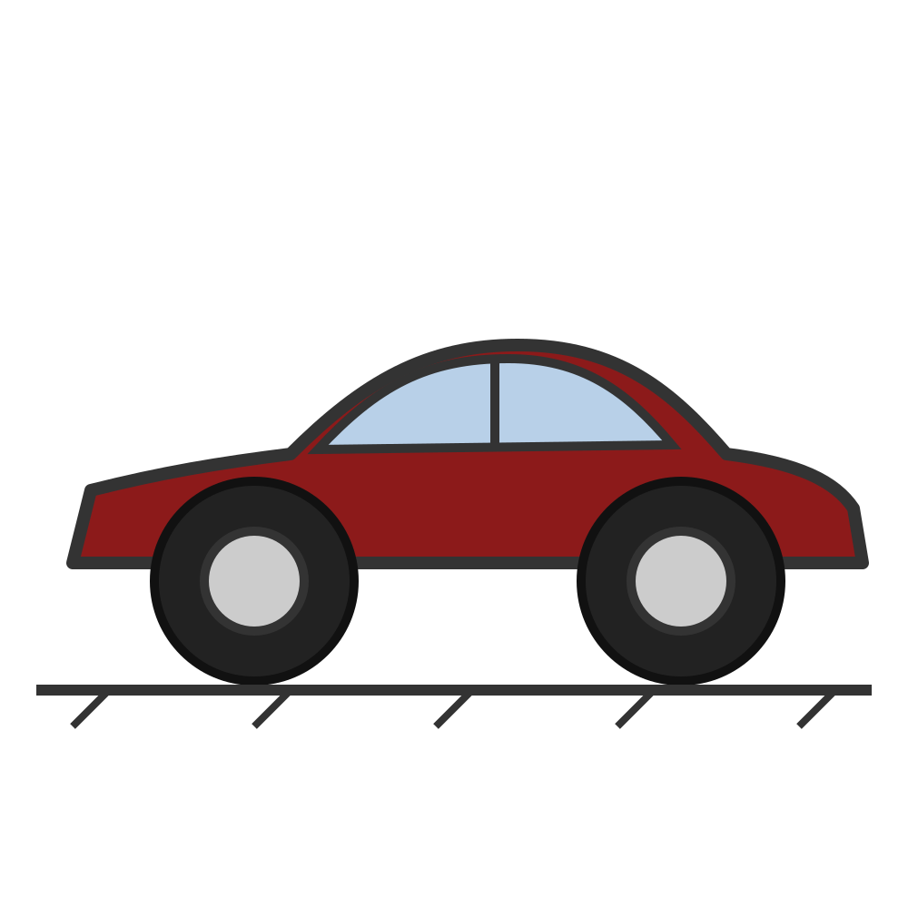

# SedanDemo



A full-vehicle sedan model in Dyad, built from 3D multibody components and
validated against [Project Chrono](https://projectchrono.org). The vehicle is
assembled from `VehicleComponents`, a small library of reusable vehicle
subsystems that ships with this demo: suspension, steering, tires, powertrain,
brakes, and drivers.

## The model

`Sedan` is a rear-wheel-drive sedan with a 1550 kg rigid chassis, four
double-wishbone corners, load-sensitive TMeasy tires, rack-and-pinion steering,
a map-based engine with a continuously variable transmission (CVT), an open
differential, and regularized friction brakes. Its causal interface is what a
driving scenario needs:

- inputs `steering` (−1…1, positive steers left), `throttle` (0…1), `braking` (0…1)
- outputs `x`, `z`, `yaw` (chassis pose in the world frame) and `v` (longitudinal speed)

It is assembled in three levels: `SedanCorner` (one suspension corner with its
wheel and brake), `SedanVehicle` (chassis, four corners, steering rack,
driveline), and `Sedan` (vehicle plus engine and CVT, with the causal
interface above).

Four closed-loop maneuvers exercise it:

| Model | What it does |
|---|---|
| `SedanSettle` | released just above ride height with zero inputs; settles onto suspension and tires |
| `SedanAcceleration` | full throttle after a 1 s settle; the CVT varies its ratio continuously |
| `SedanStepSteer` | cruise to 15 m/s, then a 0.1 steering step into a steady left turn |
| `SedanDoubleLaneChange` | ISO double lane change at 12 m/s under a look-ahead path follower |

`SedanCCRs` adds automatic emergency braking (AEB) in the Euro NCAP car-to-car
rear, stationary target scenario (CCRs): the sedan, with anti-lock brakes,
approaches a parked target at the test speed and impact location, and an AEB
controller brakes on the deceleration needed to stop short of it. The
`SedanCCRsTest` analysis runs one such test.

## VehicleComponents

`SedanDemo.VehicleComponents` holds the reusable parts. None of them is
specific to this sedan; the sedan supplies the geometry and parameters.

| Component | Description |
|---|---|
| `DoubleWishboneSuspension` | 3D double-wishbone corner: lower and upper control arms, upright, tie rod, coil-over spring-damper |
| `DoubleWishboneJoint` | closes the wishbone and tie-rod loops analytically, so the corner adds no loop-closure equations (used by `DoubleWishboneSuspension` with `closed_form = true`, the default) |
| `BallJointForce` | ball joint that only transmits force, for joint assemblies that place their frames analytically |
| `RackPinionSteering` | rack-and-pinion steering mechanism driving the tie rods |
| `TMeasyWheelJoint`, `TMeasySlippingWheel` | TMeasy semi-empirical tire with load-dependent characteristics, a low-speed bristle model, and rolling resistance |
| `EngineCVTMap` | map-based engine torque with an event-free continuously variable transmission |
| `Driveline2WD` | driveshaft, angled final drive and open differential, optionally carried as 3D rotors on the chassis |
| `Differential1D` | open differential |
| `HalfShaft` | halfshaft between the differential and a wheel joint, carrying the drive reaction correctly |
| `Brake` | regularized friction brake |
| `ABSBrake` | friction brake with an idealized anti-lock slip limiter, switched by `abs_enabled` |
| `AEBController` | automatic emergency braking on the deceleration needed to stop short of an in-path target |
| `IdealRangeSensor`, `StationaryTarget` | exact range, closing speed and in-path check against a parked target |
| `ThrottleRobot` | accelerator robot that releases the throttle as a test protocol prescribes |
| `SpeedController`, `PathFollowerDriver` | longitudinal speed control (with anti-windup) and a look-ahead lateral path follower |

The 3D mechanics (bodies, joints, world, visualization) come from
`MultibodyComponents`; rotational drivetrain parts from `RotationalComponents`;
signal blocks from `BlockComponents`.

## Getting started

Use the `dyad-3.5.0` JuliaHub distribution (Julia 1.13.2). The JuliaHub
package server requires credentials for the Dyad libraries.

From this demo directory:

```sh
julia +dyad-3.5.0 --project=. -e 'using Pkg; Pkg.instantiate()'
dyad compile .
julia +dyad-3.5.0 --project=. -e 'using Pkg; Pkg.test()'
```

Set `TEST_RENDERING=true` to also check the 3D rendering of the settled sedan
(this loads GLMakie and needs a display).

Open the folder in VS Code with the
[Dyad extension](https://help.juliahub.com/dyad/dev/getting_started/) to browse
the component diagrams. The Dyad sources live in `dyad/`; compiling generates
the Julia code in `generated/`.

To simulate a maneuver from Julia, start `julia +dyad-3.5.0 --project=scripts`
(the `scripts` environment adds the solver packages) and run:

```julia
using SedanDemo, ModelingToolkit, OrdinaryDiffEqRosenbrock
using ADTypes: AutoFiniteDiff
using DyadInterface: simplify_model

@named model = SedanDemo.SedanStepSteer()
sys = simplify_model(model)
prob = ODEProblem(sys, [], (0.0, 20.0); optimize = :basic)
sol = solve(prob, Rodas5P(autodiff = AutoFiniteDiff()))
sol(20.0, idxs = sys.sedan.yaw)
```

`scripts/parameter_sweep.jl` sweeps the full-throttle launch over road friction
and final drive ratio with DyadParameterAnalysis on CPU threads, and reports
for each road friction the best ratio and how many ratios spin the car out.
`scripts/mu_road_sensitivity.jl` shows how to vary a single parameter (the road
friction coefficient `sedan.mu_road`) on a compiled problem without rebuilding
the model.

## Validation

`test/test_vehicles.jl` regresses the four maneuvers against trajectories
logged from the original Project Chrono vehicle with the same TMeasy tire,
committed under [`test/references/sedan/`](test/references/sedan/). The tests
never need Chrono; [`validation/sedan_chrono/`](validation/sedan_chrono/) holds
the PyChrono scripts that regenerate the references.

Statics agree to a fraction of a percent (ride height, pitch, per-corner static
loads), and lateral responses to a few percent. The Chrono references use the
Chrono sedan's six-speed automatic gearbox, so the acceleration maneuver is
compared more loosely: speed within 15% from 8 s on, and the same direction
and magnitude of lateral drift.

The AEB scenario is checked against the Euro NCAP *Crash Avoidance – Frontal
Collisions* protocol (version 1.2) in
[`validation/sedan_aeb_ccrs/`](validation/sedan_aeb_ccrs/):
[`requirements.md`](validation/sedan_aeb_ccrs/requirements.md) traces each test
condition, measurement and score to the protocol, and `ccrs_sweep.jl` runs the
56-test grid (10–80 km/h, impact locations −25 % to 125 %), checks the test
conduct and scores it. With an ideal range sensor and the AEB trigger at
5 m/s² of required deceleration, the sedan stops short of the target in all 56
tests (0.91–0.98 m short) and scores the 1.35 CCRs points in scope; with later
triggers the score drops to 0.56 points at 10 m/s². This is a simulation
prediction with an ideal sensor, not a vehicle test.

```sh
julia +dyad-3.5.0 --project=validation/sedan_aeb_ccrs -e 'using Pkg; Pkg.instantiate()'
julia +dyad-3.5.0 -t 8 --project=validation/sedan_aeb_ccrs validation/sedan_aeb_ccrs/ccrs_sweep.jl --gate --sensitivity
```

## Provenance

The vehicle is a port of Project Chrono's JSON-defined sedan
([`Sedan_Vehicle.json`](https://github.com/projectchrono/chrono/blob/main/data/vehicle/sedan/vehicle/Sedan_Vehicle.json)
and the files it references). The chassis, rim, and tire meshes and the Pac02
tire property file under [`assets/sedan/`](assets/sedan/) come from the Chrono
vehicle data set, and the TMeasy tire model is ported from Chrono's
`ChTMeasyTire`. These parts are redistributed under Chrono's BSD-3-Clause
license; see [`LICENSE-Chrono.txt`](LICENSE-Chrono.txt) for the notice and the
list of covered files.

## Layout

```
dyad/                    Dyad sources
  sedan.dyad             SedanCorner, SedanVehicle, Sedan
  sedan_maneuvers.dyad   the four maneuvers
  sedan_ccrs.dyad        the AEB scenario (SedanCCRs, SedanCCRsTest)
  definitions.jl         sedan_asset(): mesh and data file resolution
  VehicleComponents/     reusable vehicle component library
generated/               Julia emitted by the Dyad compiler (do not edit)
assets/                  component icons; sedan/ holds the Chrono meshes and .tir file
scripts/                 parameter sweep and studies, and the Pac02 magic-formula tire fit
test/                    regression tests and Chrono reference trajectories
validation/sedan_chrono/ PyChrono scripts that generate the references
validation/sedan_aeb_ccrs/ Euro NCAP CCRs requirements, sweep, scoring and records
```
