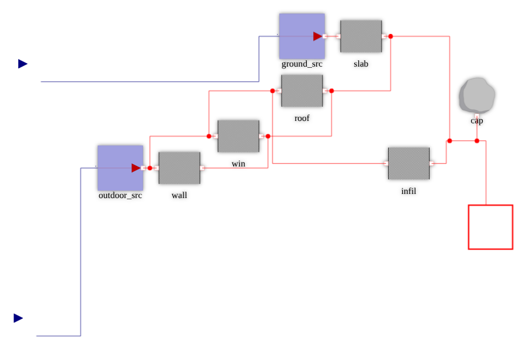
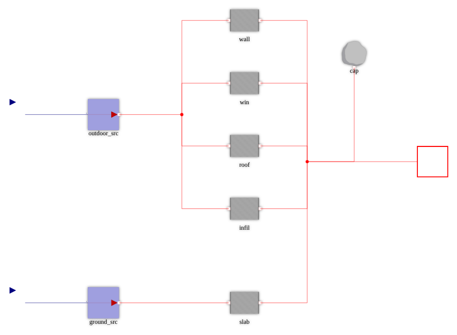
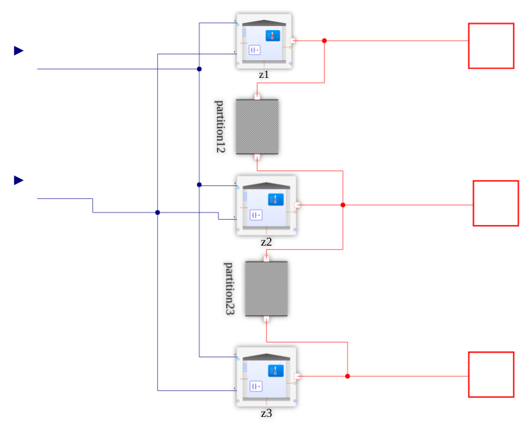
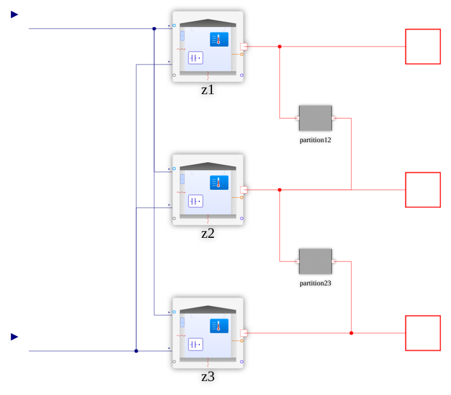
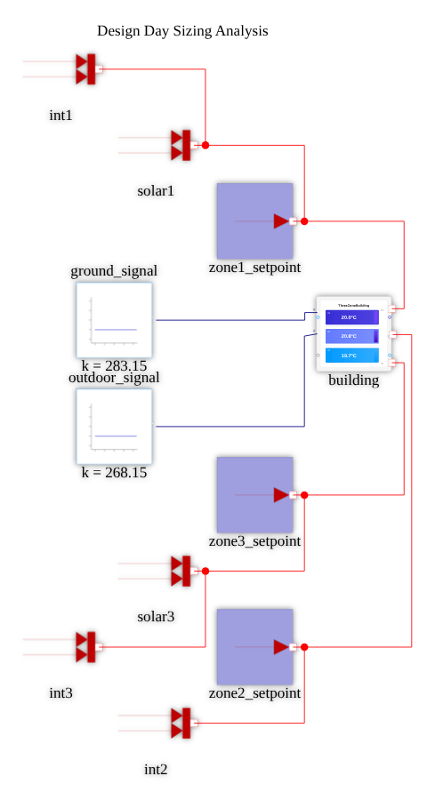
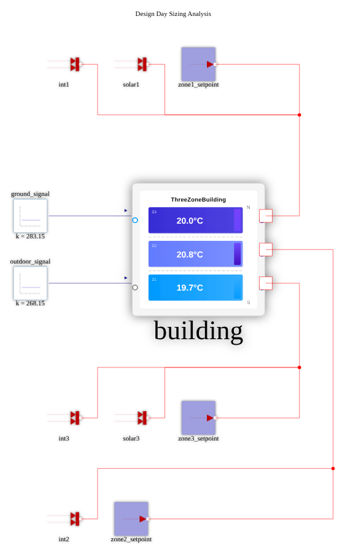
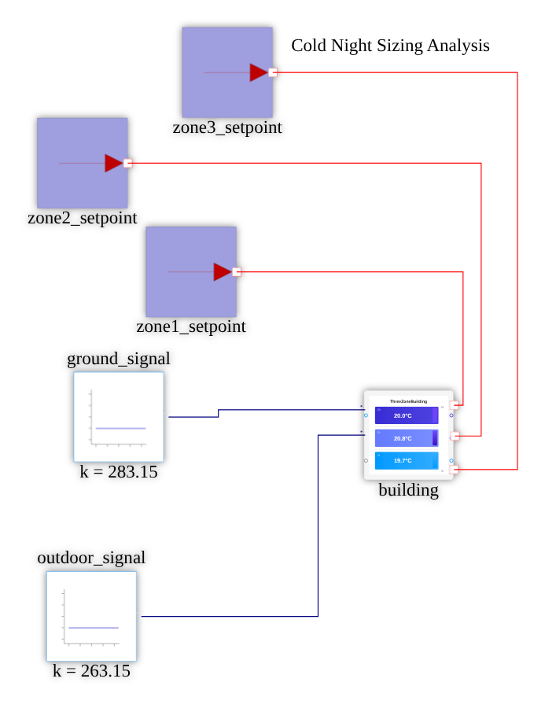
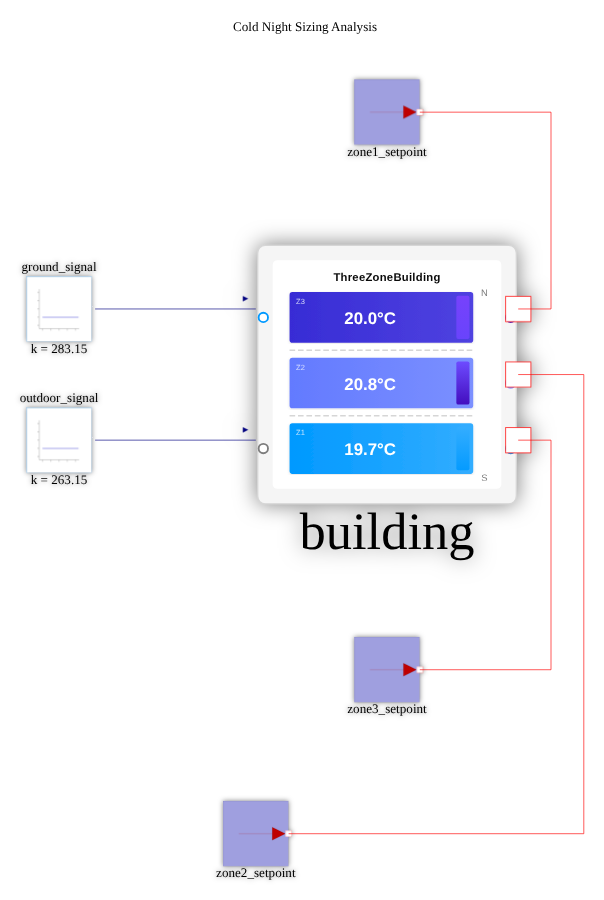
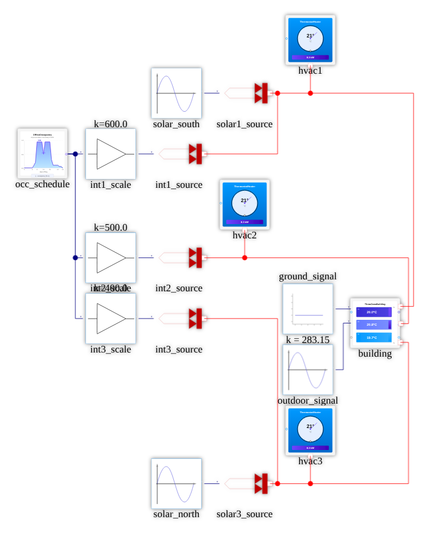
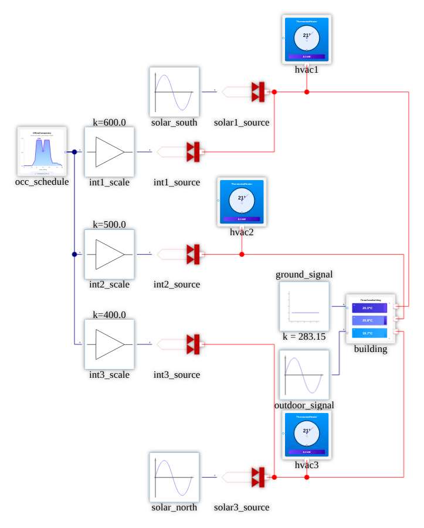

# DynamicSteadyState diagram re-layout notes

## How these were produced

Toolchain: Dyad CLI 3.5.0 (`dyad-linux-x64` from the v3.5.0 release of JuliaComputing/dyad-lang,
checked against `SHA256SUMS.txt`), `JULIA_EXECUTABLE="julia +dyad-3.5.0"`, and the layout scout's scripts
(`relayout.sh`, `edit_problem.py`, `fix_junction_order.py`, `verify_edges.py`, `svg2png.sh`).
Run every command from the demo root (the directory with `Project.toml`).

Every diagram uses the same base ops, `lock-orientation unpin-ports port-edges`, plus `pin` constraints
(and the odd `portEdge`/option) for each block. In this chunk the free hinted solver kept giving
scattered layers, wrap-around wires or fractional junction positions. Pinning each block to a planned
grid position and letting the solver do only the routing gave clean, repeatable results. Pins are in
half-squares (50 diagram units). The solver translates the whole layout, so only relative positions
matter. Pin the solver's `__junction_N` nodes onto the grid too: left free, they land on fractional
coordinates and draw diagonal stubs.

The "spec" blocks below are shorthand for the ops. `pins.py SPEC` expands a spec into
`edit_problem.py` ops (script at the end of this file), and the full expansion is listed under each
diagram. To reproduce a diagram, make the "before extract" hand edits, then run:

    inputs/tools/relayout.sh COMPONENT OUTDIR <ops listed for that diagram>

then make the "after apply" hand edits, if any. Re-running `relayout.sh` with the same ops is idempotent
(checked: the file did not change), but it does undo that diagram's after-apply hand edits.

The PNGs here come from `dyad render` + `svg2png.sh` (headless Chrome), 900 px max.
A rendering quirk you will see in every diagram: the RealInput/RealOutput glyphs draw in the top-left
21% of their connector box (the icon SVG has a fixed `width="210"`), so the small triangles look offset
from their wire ends. That comes from the icon, not the layout, and it was there before.

Diagrams were laid out bottom-up (ZoneRoom, then ThreeZoneBuilding, then the harnesses), because a child's
icon port positions decide its ports in the parent. HeatCapacitorNoInit, ThermostatHeater and
OfficeOccupancy have no subcomponents, so they have no diagram to lay out.

`layout apply` re-prints the whole file. Here that turned the `{^id}` / `"_links"` metadata style into
inline metadata, and one single-line triple-quoted docstring into a plain string. Neither changes meaning:
`dyad compile .` leaves `generated/` byte-identical and the test suite still passes (15/15).

### Icon-port changes (made by hand before laying out the parents)

- **ZoneRoom** connectors previously had only `diagram` placements, so their icon ports fell back to
  wherever the diagram ports were and would move with every re-layout. I added explicit `icon` placements
  on the icon art's dots, snapped so they land on the 50-unit grid in a 200x200 instance box:
  T_outdoor `(-50,200)-(50,300)` (blue dot, top-left), T_ground `(-50,700)-(50,800)` (grey dot, bottom-left; the art dot
  is at about 900), zone_port `(950,450)-(1050,550)` (orange dot at about 607).
- **ThreeZoneBuilding** connectors: added explicit `icon` placements on the art's dot rows (about 28%/53%/78%):
  T_ground `(-50,200)-(50,300)`, T_outdoor `(-50,700)-(50,800)`, zone1 `(950,200)-(1050,300)`,
  zone2 `(950,450)-(1050,550)`, zone3 `(950,700)-(1050,800)`. This keeps the port order all three
  harnesses already used (ground above outdoor, zone1 at the top).
  Known mismatch, which predates this change: the icon art colours the top-left dot as outdoor and labels the top
  zone "Z3 / N". Matching the art would mean flipping the zone rows of the hand-made
  TestDiurnalOperation, so I left the semantics alone.

## Diagrams

### ZoneRoom

**Before:** C. Staircase layout, input wires ending away from their port glyphs, and the slab and roof rows tangled through each other.

**Hand edits before extract:** the icon placements above (they don't affect this diagram).

Spec:

```
# ZoneRoom: outdoor/ground sources -> one column of envelope resistors -> zone node bus -> zone_port.
raw grid:13x12
T_outdoor 0 10
outdoor_src 5 10
T_ground 0 22
ground_src 5 22
wall 14 4
win 14 8
roof 14 12
infil 14 16
slab 14 22
cap 21 6
zone_port 26 13
__junction_2 10 10
__junction_4 18 13
```

Exact ops:

```
inputs/tools/relayout.sh ZoneRoom OUTDIR \
  lock-orientation \
  unpin-ports \
  port-edges \
  grid:13x12 \
  'add:{"id": "pin:T_outdoor", "kind": {"kind": "pin", "componentId": "T_outdoor", "at": {"x": 0.0, "y": 10.0}}, "strength": {"tier": "required", "weight": 1}}' \
  'add:{"id": "pin:outdoor_src", "kind": {"kind": "pin", "componentId": "outdoor_src", "at": {"x": 5.0, "y": 10.0}}, "strength": {"tier": "required", "weight": 1}}' \
  'add:{"id": "pin:T_ground", "kind": {"kind": "pin", "componentId": "T_ground", "at": {"x": 0.0, "y": 22.0}}, "strength": {"tier": "required", "weight": 1}}' \
  'add:{"id": "pin:ground_src", "kind": {"kind": "pin", "componentId": "ground_src", "at": {"x": 5.0, "y": 22.0}}, "strength": {"tier": "required", "weight": 1}}' \
  'add:{"id": "pin:wall", "kind": {"kind": "pin", "componentId": "wall", "at": {"x": 14.0, "y": 4.0}}, "strength": {"tier": "required", "weight": 1}}' \
  'add:{"id": "pin:win", "kind": {"kind": "pin", "componentId": "win", "at": {"x": 14.0, "y": 8.0}}, "strength": {"tier": "required", "weight": 1}}' \
  'add:{"id": "pin:roof", "kind": {"kind": "pin", "componentId": "roof", "at": {"x": 14.0, "y": 12.0}}, "strength": {"tier": "required", "weight": 1}}' \
  'add:{"id": "pin:infil", "kind": {"kind": "pin", "componentId": "infil", "at": {"x": 14.0, "y": 16.0}}, "strength": {"tier": "required", "weight": 1}}' \
  'add:{"id": "pin:slab", "kind": {"kind": "pin", "componentId": "slab", "at": {"x": 14.0, "y": 22.0}}, "strength": {"tier": "required", "weight": 1}}' \
  'add:{"id": "pin:cap", "kind": {"kind": "pin", "componentId": "cap", "at": {"x": 21.0, "y": 6.0}}, "strength": {"tier": "required", "weight": 1}}' \
  'add:{"id": "pin:zone_port", "kind": {"kind": "pin", "componentId": "zone_port", "at": {"x": 26.0, "y": 13.0}}, "strength": {"tier": "required", "weight": 1}}' \
  'add:{"id": "pin:__junction_2", "kind": {"kind": "pin", "componentId": "__junction_2", "at": {"x": 10.0, "y": 10.0}}, "strength": {"tier": "required", "weight": 1}}' \
  'add:{"id": "pin:__junction_4", "kind": {"kind": "pin", "componentId": "__junction_4", "at": {"x": 18.0, "y": 13.0}}, "strength": {"tier": "required", "weight": 1}}'
```

**Hand edits after apply:** none

**Result:** Outdoor and ground sources on the left. One column of envelope resistors (wall, win, roof, infil, slab) between an outdoor bus and a zone bus. Capacitor on the zone bus, zone_port on the right. Both junctions pinned onto the buses (the multi-way junction fix ran, and every arm lands on the correct port). 0 crossings.

| before | after |
|---|---|
|  |  |

### ThreeZoneBuilding

**Before:** C. Partitions rotated 90 degrees (rotated labels), port wires running diagonally/offset into the ports, zone ports overlapping.

**Hand edits before extract:** the icon placements above. z1/z2/z3 boxes set to 200x200 (`x1 400..600`) so their ports sit on the grid, and partitions set to unrotated 100x100 boxes.

Spec:

```
# ThreeZoneBuilding: zones stacked (z1 top), partitions in a staircase on the right, outdoor/ground buses on the left.
# Zone boxes set to 200x200 and partitions to unrotated 100x100 by hand before extract.
raw grid:12x12
T_outdoor 0 3
T_ground 0 21
z1 10 4
z2 10 12
z3 10 20
partition12 16 8
partition23 16 16
zone1_port 22 4
zone2_port 22 12
zone3_port 22 20
__junction_2 7 3
__junction_0 6 21
__junction_3 14 4
__junction_1 14 12
__junction_4 18 20
```

Exact ops:

```
inputs/tools/relayout.sh ThreeZoneBuilding OUTDIR \
  lock-orientation \
  unpin-ports \
  port-edges \
  grid:12x12 \
  'add:{"id": "pin:T_outdoor", "kind": {"kind": "pin", "componentId": "T_outdoor", "at": {"x": 0.0, "y": 3.0}}, "strength": {"tier": "required", "weight": 1}}' \
  'add:{"id": "pin:T_ground", "kind": {"kind": "pin", "componentId": "T_ground", "at": {"x": 0.0, "y": 21.0}}, "strength": {"tier": "required", "weight": 1}}' \
  'add:{"id": "pin:z1", "kind": {"kind": "pin", "componentId": "z1", "at": {"x": 10.0, "y": 4.0}}, "strength": {"tier": "required", "weight": 1}}' \
  'add:{"id": "pin:z2", "kind": {"kind": "pin", "componentId": "z2", "at": {"x": 10.0, "y": 12.0}}, "strength": {"tier": "required", "weight": 1}}' \
  'add:{"id": "pin:z3", "kind": {"kind": "pin", "componentId": "z3", "at": {"x": 10.0, "y": 20.0}}, "strength": {"tier": "required", "weight": 1}}' \
  'add:{"id": "pin:partition12", "kind": {"kind": "pin", "componentId": "partition12", "at": {"x": 16.0, "y": 8.0}}, "strength": {"tier": "required", "weight": 1}}' \
  'add:{"id": "pin:partition23", "kind": {"kind": "pin", "componentId": "partition23", "at": {"x": 16.0, "y": 16.0}}, "strength": {"tier": "required", "weight": 1}}' \
  'add:{"id": "pin:zone1_port", "kind": {"kind": "pin", "componentId": "zone1_port", "at": {"x": 22.0, "y": 4.0}}, "strength": {"tier": "required", "weight": 1}}' \
  'add:{"id": "pin:zone2_port", "kind": {"kind": "pin", "componentId": "zone2_port", "at": {"x": 22.0, "y": 12.0}}, "strength": {"tier": "required", "weight": 1}}' \
  'add:{"id": "pin:zone3_port", "kind": {"kind": "pin", "componentId": "zone3_port", "at": {"x": 22.0, "y": 20.0}}, "strength": {"tier": "required", "weight": 1}}' \
  'add:{"id": "pin:__junction_2", "kind": {"kind": "pin", "componentId": "__junction_2", "at": {"x": 7.0, "y": 3.0}}, "strength": {"tier": "required", "weight": 1}}' \
  'add:{"id": "pin:__junction_0", "kind": {"kind": "pin", "componentId": "__junction_0", "at": {"x": 6.0, "y": 21.0}}, "strength": {"tier": "required", "weight": 1}}' \
  'add:{"id": "pin:__junction_3", "kind": {"kind": "pin", "componentId": "__junction_3", "at": {"x": 14.0, "y": 4.0}}, "strength": {"tier": "required", "weight": 1}}' \
  'add:{"id": "pin:__junction_1", "kind": {"kind": "pin", "componentId": "__junction_1", "at": {"x": 14.0, "y": 12.0}}, "strength": {"tier": "required", "weight": 1}}' \
  'add:{"id": "pin:__junction_4", "kind": {"kind": "pin", "componentId": "__junction_4", "at": {"x": 18.0, "y": 20.0}}, "strength": {"tier": "required", "weight": 1}}'
```

**Hand edits after apply:** none

**Result:** Zones stacked in a column. Partitions form a staircase to their right, each bridging two zone nets, and each zone net runs straight out to its canvas port. The outdoor and ground buses fan out on the left. The 2 crossings (ground arms passing the outdoor bus) are forced, because each zone's outdoor port sits above its ground port. All 5 multi-way nets are pinned at junctions on the grid.

| before | after |
|---|---|
|  |  |

### TestSteadySizing

**Before:** D. One long thin column: loads scattered top to bottom with long wraps into the building's right side, and the free-text title off in a corner.

**Hand edits before extract:** `building` box 400x400 (`x1 400..800`), so its ports are 200 apart on the grid.

Spec:

```
# TestSteadySizing: signals left of the building; one row of loads per zone, each joined on a bus that
# wraps to the building's right-side zone port (zone1 row above, zone3 and zone2 rows below, nested so no wires cross).
# Building box set to 400x400 by hand before extract.
raw grid:17x18
ground_signal 10 14
outdoor_signal 10 18
building 20 16
int1 12 5
solar1 16 5
zone1_setpoint 20 5
__junction_2 26 8
int3 12 26
solar3 16 26
zone3_setpoint 20 26
__junction_4 26 23
int2 12 32
zone2_setpoint 16 32
__junction_3 28 29
```

Exact ops:

```
inputs/tools/relayout.sh TestSteadySizing OUTDIR \
  lock-orientation \
  unpin-ports \
  port-edges \
  grid:17x18 \
  'add:{"id": "pin:ground_signal", "kind": {"kind": "pin", "componentId": "ground_signal", "at": {"x": 10.0, "y": 14.0}}, "strength": {"tier": "required", "weight": 1}}' \
  'add:{"id": "pin:outdoor_signal", "kind": {"kind": "pin", "componentId": "outdoor_signal", "at": {"x": 10.0, "y": 18.0}}, "strength": {"tier": "required", "weight": 1}}' \
  'add:{"id": "pin:building", "kind": {"kind": "pin", "componentId": "building", "at": {"x": 20.0, "y": 16.0}}, "strength": {"tier": "required", "weight": 1}}' \
  'add:{"id": "pin:int1", "kind": {"kind": "pin", "componentId": "int1", "at": {"x": 12.0, "y": 5.0}}, "strength": {"tier": "required", "weight": 1}}' \
  'add:{"id": "pin:solar1", "kind": {"kind": "pin", "componentId": "solar1", "at": {"x": 16.0, "y": 5.0}}, "strength": {"tier": "required", "weight": 1}}' \
  'add:{"id": "pin:zone1_setpoint", "kind": {"kind": "pin", "componentId": "zone1_setpoint", "at": {"x": 20.0, "y": 5.0}}, "strength": {"tier": "required", "weight": 1}}' \
  'add:{"id": "pin:__junction_2", "kind": {"kind": "pin", "componentId": "__junction_2", "at": {"x": 26.0, "y": 8.0}}, "strength": {"tier": "required", "weight": 1}}' \
  'add:{"id": "pin:int3", "kind": {"kind": "pin", "componentId": "int3", "at": {"x": 12.0, "y": 26.0}}, "strength": {"tier": "required", "weight": 1}}' \
  'add:{"id": "pin:solar3", "kind": {"kind": "pin", "componentId": "solar3", "at": {"x": 16.0, "y": 26.0}}, "strength": {"tier": "required", "weight": 1}}' \
  'add:{"id": "pin:zone3_setpoint", "kind": {"kind": "pin", "componentId": "zone3_setpoint", "at": {"x": 20.0, "y": 26.0}}, "strength": {"tier": "required", "weight": 1}}' \
  'add:{"id": "pin:__junction_4", "kind": {"kind": "pin", "componentId": "__junction_4", "at": {"x": 26.0, "y": 23.0}}, "strength": {"tier": "required", "weight": 1}}' \
  'add:{"id": "pin:int2", "kind": {"kind": "pin", "componentId": "int2", "at": {"x": 12.0, "y": 32.0}}, "strength": {"tier": "required", "weight": 1}}' \
  'add:{"id": "pin:zone2_setpoint", "kind": {"kind": "pin", "componentId": "zone2_setpoint", "at": {"x": 16.0, "y": 32.0}}, "strength": {"tier": "required", "weight": 1}}' \
  'add:{"id": "pin:__junction_3", "kind": {"kind": "pin", "componentId": "__junction_3", "at": {"x": 28.0, "y": 29.0}}, "strength": {"tier": "required", "weight": 1}}'
```

**Hand edits after apply:** Moved the diagram-layer label "Design Day Sizing Analysis" from (230, 20) to (925, 100), centred above the content. Layout never moves free text.

**Result:** Boundary signals on the left, each level with its building port. One row of loads per zone, each joined on a bus that wraps to that zone's port on the building's right side. zone1's row is above. zone3's and then zone2's rows are below, nested so no wires cross. (This is the same nesting the original author used.) 0 crossings.

| before | after |
|---|---|
|  |  |

### TestColdNightSizing

**Before:** D. Setpoints scattered in a staircase above the building, with long wraps, and the free-text title off to the side.

**Hand edits before extract:** `building` box 400x400.

Spec:

```
# TestColdNightSizing: same scheme as TestSteadySizing with one setpoint per zone
# (zone1 above, zone3 then zone2 below, wires nested around the building's right side). Building box 400x400 by hand.
raw grid:15x16
ground_signal 10 14
outdoor_signal 10 18
building 20 16
zone1_setpoint 20 8
zone3_setpoint 20 25
zone2_setpoint 16 30
```

Exact ops:

```
inputs/tools/relayout.sh TestColdNightSizing OUTDIR \
  lock-orientation \
  unpin-ports \
  port-edges \
  grid:15x16 \
  'add:{"id": "pin:ground_signal", "kind": {"kind": "pin", "componentId": "ground_signal", "at": {"x": 10.0, "y": 14.0}}, "strength": {"tier": "required", "weight": 1}}' \
  'add:{"id": "pin:outdoor_signal", "kind": {"kind": "pin", "componentId": "outdoor_signal", "at": {"x": 10.0, "y": 18.0}}, "strength": {"tier": "required", "weight": 1}}' \
  'add:{"id": "pin:building", "kind": {"kind": "pin", "componentId": "building", "at": {"x": 20.0, "y": 16.0}}, "strength": {"tier": "required", "weight": 1}}' \
  'add:{"id": "pin:zone1_setpoint", "kind": {"kind": "pin", "componentId": "zone1_setpoint", "at": {"x": 20.0, "y": 8.0}}, "strength": {"tier": "required", "weight": 1}}' \
  'add:{"id": "pin:zone3_setpoint", "kind": {"kind": "pin", "componentId": "zone3_setpoint", "at": {"x": 20.0, "y": 25.0}}, "strength": {"tier": "required", "weight": 1}}' \
  'add:{"id": "pin:zone2_setpoint", "kind": {"kind": "pin", "componentId": "zone2_setpoint", "at": {"x": 16.0, "y": 30.0}}, "strength": {"tier": "required", "weight": 1}}'
```

**Hand edits after apply:** Moved the label "Cold Night Sizing Analysis" from (630, 80) to (875, 270), centred above the content.

**Result:** Same scheme as TestSteadySizing with one setpoint per zone. 0 crossings.

| before | after |
|---|---|
|  |  |

### TestDiurnalOperation

**Before:** A-, a good hand layout. Kept as is; it was **not** re-run through the solver.

**Hand edits only** (diagram units):
- `int2_scale`'s label overlapped `int3_scale`'s `k=400.0` label: moved `int3_scale` and `int3_source` down by 60
  (`y 570..670` became `630..730`), and moved the matching wire points `{135,620}` and `{535,620}` to y=680.
- `ground_signal`'s `k = 283.15` label touched the top of `outdoor_signal`: moved `outdoor_signal` and `hvac3` down 20
  (`outdoor_signal 671..771` became `691..791`, `hvac3 791..891` became `811..911`). The outdoor wire point `{665,721}` became `{665,741}`.
- Followed the new ThreeZoneBuilding icon ports: the outdoor wire's last point became `{665,654}`, the zone-port wire points
  became `{804,604}` / `{794,629}` / `{794,654}` (were 596 / 630 / 667), and `ground_signal` moved down 3 (`551..651` became `554..654`)
  so its wire into T_ground (now y=604) stays straight.

**Result:** the same layout, with no overlapping labels and straight wires into the building.

| before | after |
|---|---|
|  |  |

## Appendix: pins.py

```python
#!/usr/bin/env python3
"""pins.py SPECFILE -> prints edit_problem.py ops, one per line.
Spec lines:  id x y [d4]   (pin a component/canvas connector, half-squares)
             edge id side    (portEdge for a canvas connector)
             order a b dir | align h|v id id ... | bump id n | raw <op>   ('#' comments)"""
import json, sys
n = 0
for line in open(sys.argv[1]):
    t = line.split('#')[0].split()
    if not t: continue
    n += 1
    if t[0] == 'edge':
        print('add:' + json.dumps({"id": f"portEdge:{t[1]}", "kind": {"kind": "portEdge", "connectorId": t[1], "edge": t[2]}, "strength": {"tier": "required", "weight": 1}}))
    elif t[0] == 'order':
        print('add:' + json.dumps({"id": f"order{n}", "kind": {"kind": "order", "a": t[1], "b": t[2], "dir": t[3]}}))
    elif t[0] == 'align':
        print('add:' + json.dumps({"id": f"align{n}", "kind": {"kind": "align", "componentIds": t[2:], "axis": {"h": "horizontal", "v": "vertical"}[t[1]]}}))
    elif t[0] == 'bump':
        print('add:' + json.dumps({"id": f"bump{n}", "kind": {"kind": "bump", "componentId": t[1], "by": int(t[2])}}))
    elif t[0] == 'raw':
        print(t[1])
    else:
        print('add:' + json.dumps({"id": f"pin:{t[0]}", "kind": {"kind": "pin", "componentId": t[0], "at": {"x": float(t[1]), "y": float(t[2])}}, "strength": {"tier": "required", "weight": 1}}))
        if len(t) > 3:
            print('add:' + json.dumps({"id": f"orientation:{t[0]}", "kind": {"kind": "orientation", "componentId": t[0], "d4": t[3]}, "strength": {"tier": "required", "weight": 1}}))
```
