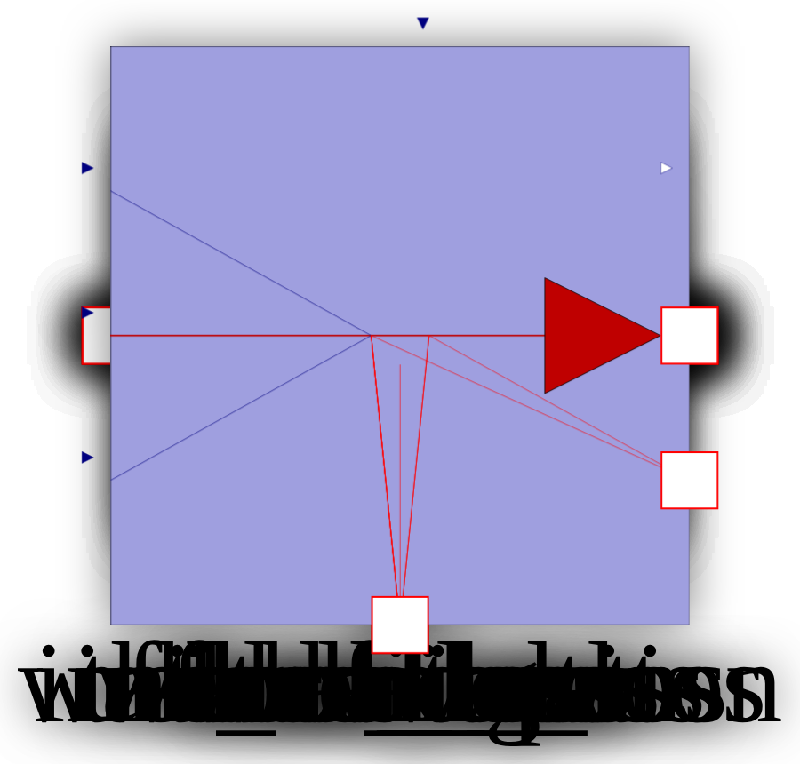
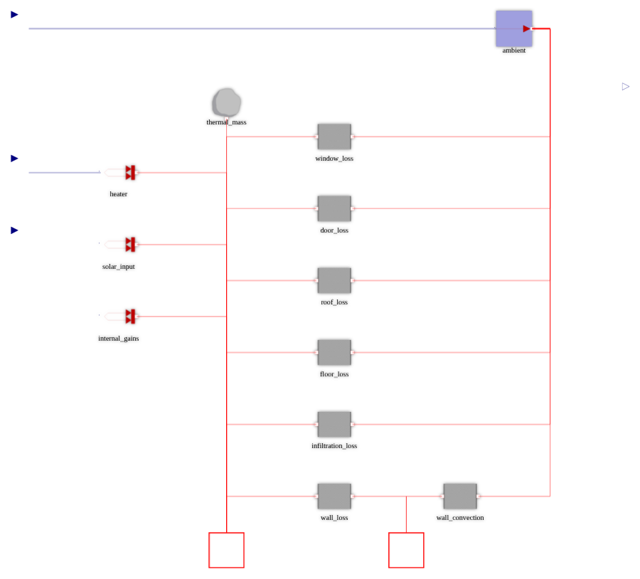
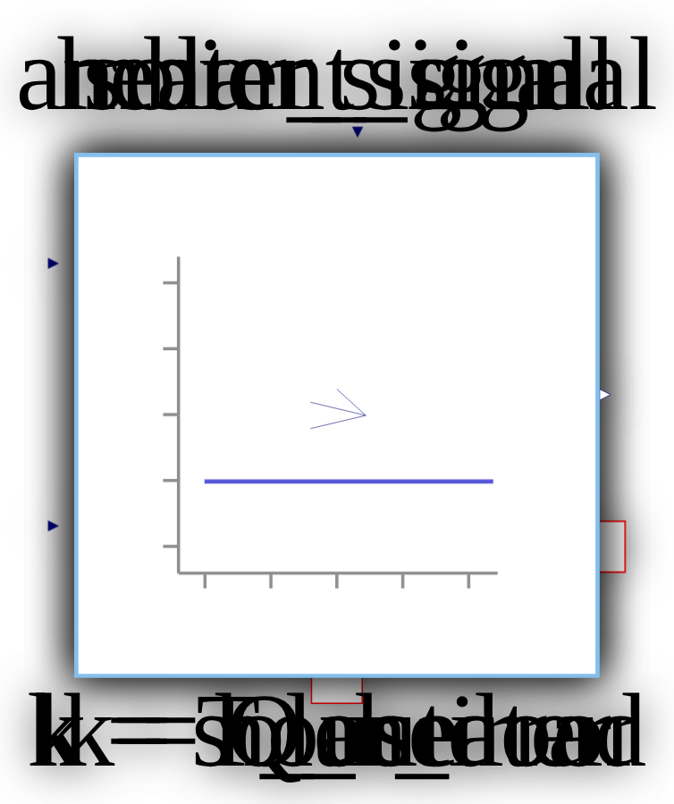
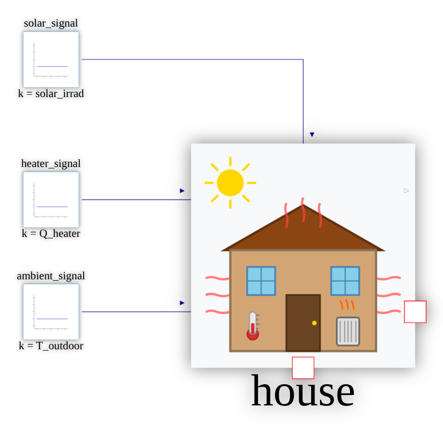
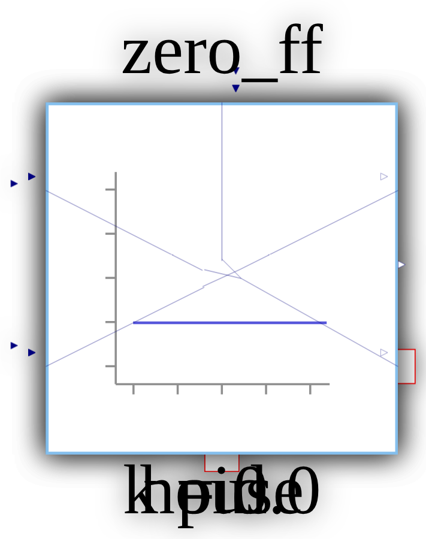
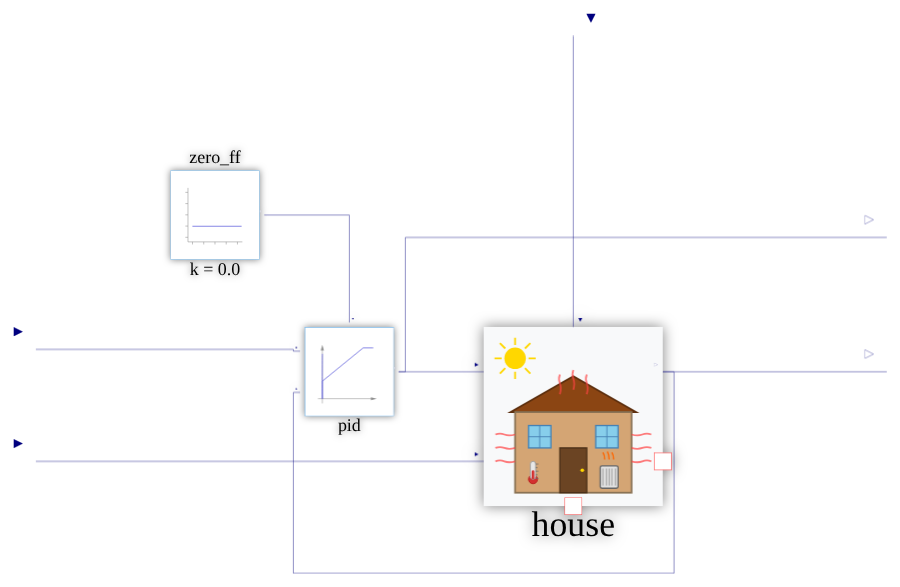
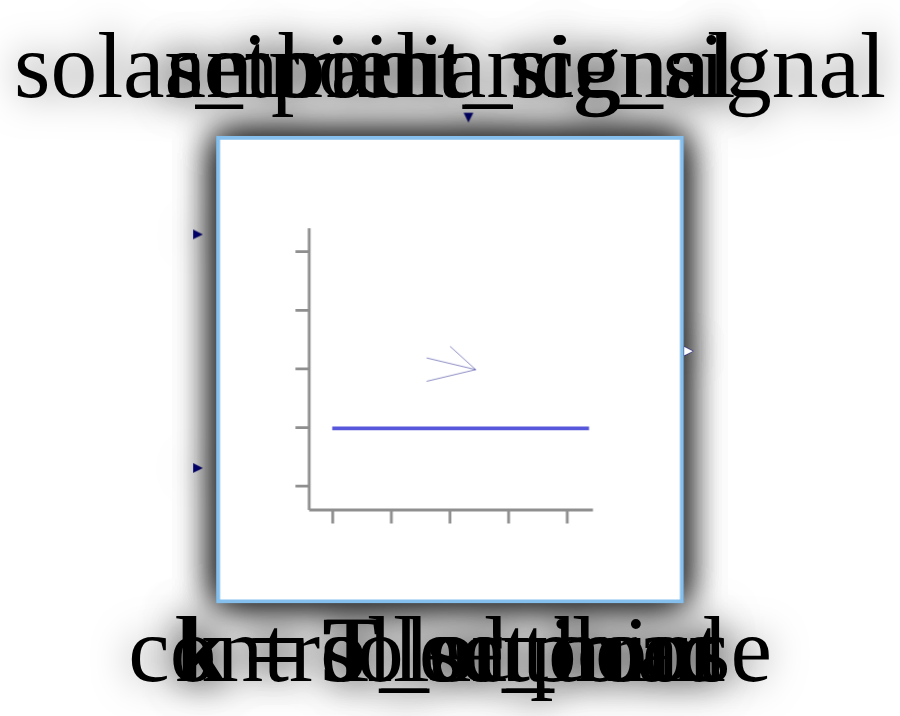
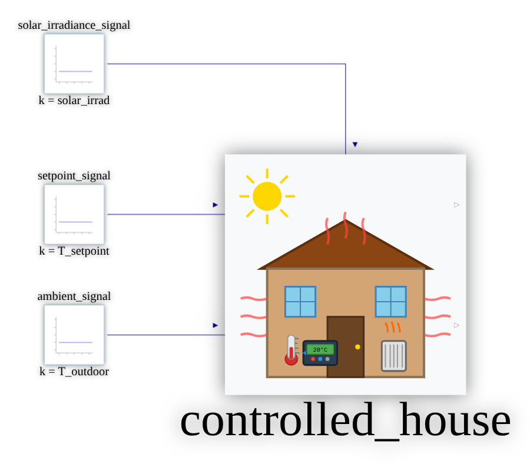

# ThermalHouseDemo diagram re-layout notes

## How these were produced

Toolchain: Dyad CLI 3.5.0 (`dyad-linux-x64` from the v3.5.0 release of JuliaComputing/dyad-lang,
checked against `SHA256SUMS.txt`), `JULIA_EXECUTABLE="julia +dyad-3.5.0"`, and the layout scout's scripts
(`relayout.sh`, `edit_problem.py`, `fix_junction_order.py`, `verify_edges.py`, `svg2png.sh`).
Run every command from the demo root (the directory with `Project.toml`).

Every diagram uses the same base ops, `lock-orientation unpin-ports port-edges`, plus `pin` constraints
(and the odd `portEdge`/option) for each block. In this chunk the free hinted solver kept giving
scattered layers, wrap-around wires or fractional junction positions. Pinning each block to a planned
grid position and letting the solver do only the routing gave clean, repeatable results. Pins are in
half-squares (50 diagram units). The solver translates the whole layout, so only relative positions
matter. Pin the solver's `__junction_N` nodes onto the grid too: left free, they land on fractional
coordinates and draw diagonal stubs.

The "spec" blocks below are shorthand for the ops. `pins.py SPEC` expands a spec into
`edit_problem.py` ops (script at the end of this file), and the full expansion is listed under each
diagram. To reproduce a diagram, make the "before extract" hand edits, then run:

    inputs/tools/relayout.sh COMPONENT OUTDIR <ops listed for that diagram>

then make the "after apply" hand edits, if any. Re-running `relayout.sh` with the same ops is idempotent
(checked: the file did not change), but it does undo that diagram's after-apply hand edits.

The PNGs here come from `dyad render` + `svg2png.sh` (headless Chrome), 900 px max.
A rendering quirk you will see in every diagram: the RealInput/RealOutput glyphs draw in the top-left
21% of their connector box (the icon SVG has a fixed `width="210"`), so the small triangles look offset
from their wire ends. That comes from the icon, not the layout, and it was there before.

## Diagrams

### ThermalHouse

**Before:** F. None of the 12 blocks had a placement, so they all sat stacked at the default position. `interior` (fan-in 10) and every wire collapsed into one point.

**Hand edits before extract:** gave `solar_irradiance` an explicit unrotated diagram placement `{"x1": -50, "y1": 450, "x2": 50, "y2": 550}` next to its icon placement. Otherwise apply copies the icon's `rot: 90` onto the left-edge diagram port and the triangle points down.

Spec:

```
# ThermalHouse: sources -> interior bus (canvas port bottom) -> envelope losses -> ambient bus.
# Pins are relative: the solver translates the whole layout, so port rows were tuned against the solved positions.
raw grid:17x16
T_ambient 0 3
ambient 27 2
Q_heater 0 11
solar_irradiance 0 15
heater 5 10
solar_input 5 14
internal_gains 5 18
thermal_mass 11 6
interior 11 32
window_loss 17 8
door_loss 17 12
roof_loss 17 16
floor_loss 17 20
infiltration_loss 17 24
wall_loss 17 28
wall_convection 24 28
wall_surface 21 32
T_interior 34 7
```

Exact ops:

```
inputs/tools/relayout.sh ThermalHouse OUTDIR \
  lock-orientation \
  unpin-ports \
  port-edges \
  grid:17x16 \
  'add:{"id": "pin:T_ambient", "kind": {"kind": "pin", "componentId": "T_ambient", "at": {"x": 0.0, "y": 3.0}}, "strength": {"tier": "required", "weight": 1}}' \
  'add:{"id": "pin:ambient", "kind": {"kind": "pin", "componentId": "ambient", "at": {"x": 27.0, "y": 2.0}}, "strength": {"tier": "required", "weight": 1}}' \
  'add:{"id": "pin:Q_heater", "kind": {"kind": "pin", "componentId": "Q_heater", "at": {"x": 0.0, "y": 11.0}}, "strength": {"tier": "required", "weight": 1}}' \
  'add:{"id": "pin:solar_irradiance", "kind": {"kind": "pin", "componentId": "solar_irradiance", "at": {"x": 0.0, "y": 15.0}}, "strength": {"tier": "required", "weight": 1}}' \
  'add:{"id": "pin:heater", "kind": {"kind": "pin", "componentId": "heater", "at": {"x": 5.0, "y": 10.0}}, "strength": {"tier": "required", "weight": 1}}' \
  'add:{"id": "pin:solar_input", "kind": {"kind": "pin", "componentId": "solar_input", "at": {"x": 5.0, "y": 14.0}}, "strength": {"tier": "required", "weight": 1}}' \
  'add:{"id": "pin:internal_gains", "kind": {"kind": "pin", "componentId": "internal_gains", "at": {"x": 5.0, "y": 18.0}}, "strength": {"tier": "required", "weight": 1}}' \
  'add:{"id": "pin:thermal_mass", "kind": {"kind": "pin", "componentId": "thermal_mass", "at": {"x": 11.0, "y": 6.0}}, "strength": {"tier": "required", "weight": 1}}' \
  'add:{"id": "pin:interior", "kind": {"kind": "pin", "componentId": "interior", "at": {"x": 11.0, "y": 32.0}}, "strength": {"tier": "required", "weight": 1}}' \
  'add:{"id": "pin:window_loss", "kind": {"kind": "pin", "componentId": "window_loss", "at": {"x": 17.0, "y": 8.0}}, "strength": {"tier": "required", "weight": 1}}' \
  'add:{"id": "pin:door_loss", "kind": {"kind": "pin", "componentId": "door_loss", "at": {"x": 17.0, "y": 12.0}}, "strength": {"tier": "required", "weight": 1}}' \
  'add:{"id": "pin:roof_loss", "kind": {"kind": "pin", "componentId": "roof_loss", "at": {"x": 17.0, "y": 16.0}}, "strength": {"tier": "required", "weight": 1}}' \
  'add:{"id": "pin:floor_loss", "kind": {"kind": "pin", "componentId": "floor_loss", "at": {"x": 17.0, "y": 20.0}}, "strength": {"tier": "required", "weight": 1}}' \
  'add:{"id": "pin:infiltration_loss", "kind": {"kind": "pin", "componentId": "infiltration_loss", "at": {"x": 17.0, "y": 24.0}}, "strength": {"tier": "required", "weight": 1}}' \
  'add:{"id": "pin:wall_loss", "kind": {"kind": "pin", "componentId": "wall_loss", "at": {"x": 17.0, "y": 28.0}}, "strength": {"tier": "required", "weight": 1}}' \
  'add:{"id": "pin:wall_convection", "kind": {"kind": "pin", "componentId": "wall_convection", "at": {"x": 24.0, "y": 28.0}}, "strength": {"tier": "required", "weight": 1}}' \
  'add:{"id": "pin:wall_surface", "kind": {"kind": "pin", "componentId": "wall_surface", "at": {"x": 21.0, "y": 32.0}}, "strength": {"tier": "required", "weight": 1}}' \
  'add:{"id": "pin:T_interior", "kind": {"kind": "pin", "componentId": "T_interior", "at": {"x": 34.0, "y": 7.0}}, "strength": {"tier": "required", "weight": 1}}'
```

**Hand edits after apply:** none

**Result:** Heat sources (heater, solar_input, internal_gains) feed a vertical `interior` bus (canvas port on the bottom edge, thermal_mass on top of it). The bus feeds one column of envelope conductors, which join an `ambient` bus at the top right. `wall_surface` drops to the bottom edge between wall_loss and wall_convection. `ambient` stays unmirrored: `flipV`/`flipH` mirror the instance label text too. So it sits at the top right with T_ambient's wire along the top row. `solar_irradiance` (equation-only) is pinned level with solar_input. 0 crossings, no rotated text.

| before | after |
|---|---|
|  |  |

### TestThermalHouse

**Before:** F. All four blocks stacked at the default position.

**Hand edits before extract:** gave `house` a 400x400 diagram box (`{"x1": 500, "y1": 300, "x2": 900, "y2": 700}`). At the default 100 units its two left inputs are only 50 apart, and the signal blocks (with labels above and below) need about 200 between rows.

Spec:

```
# house box enlarged to 400x400 by hand (diagram placement) before extract, so its left ports are 200 apart.
raw grid:10x9
house 13 9
solar_signal 4 2
heater_signal 4 7
ambient_signal 4 11
```

Exact ops:

```
inputs/tools/relayout.sh TestThermalHouse OUTDIR \
  lock-orientation \
  unpin-ports \
  port-edges \
  grid:10x9 \
  'add:{"id": "pin:house", "kind": {"kind": "pin", "componentId": "house", "at": {"x": 13.0, "y": 9.0}}, "strength": {"tier": "required", "weight": 1}}' \
  'add:{"id": "pin:solar_signal", "kind": {"kind": "pin", "componentId": "solar_signal", "at": {"x": 4.0, "y": 2.0}}, "strength": {"tier": "required", "weight": 1}}' \
  'add:{"id": "pin:heater_signal", "kind": {"kind": "pin", "componentId": "heater_signal", "at": {"x": 4.0, "y": 7.0}}, "strength": {"tier": "required", "weight": 1}}' \
  'add:{"id": "pin:ambient_signal", "kind": {"kind": "pin", "componentId": "ambient_signal", "at": {"x": 4.0, "y": 11.0}}, "strength": {"tier": "required", "weight": 1}}'
```

**Hand edits after apply:** none

**Result:** Three constant sources in a column, each level with its house port. solar_signal enters from above into the top port. 0 crossings, straight wires. The `house` label is large because Dyad scales instance labels with the box.

| before | after |
|---|---|
|  |  |

### ThermalHouseControlled

**Before:** F. All blocks stacked. The PI loop and boundary wires collapsed into diagonals.

**Hand edits before extract:** `house` box 400x400 and `pid` box 200x200 (`{"x1": 200, "y1": 300, "x2": 400, "y2": 500}`): pid's u_s/u_m were 46 units apart. `zero_ff` box 200x200 so its label matches pid's. `solar_irradiance` unrotated diagram placement (as in ThermalHouse; the after-apply step sets the final rotation).

Spec:

```
# house box 400x400, pid and zero_ff boxes 200x200 set by hand before extract (pid u_s/u_m were 46 units apart).
raw opt:routingRefinement=1
raw grid:15x11
zero_ff 4 2
pid 10 9
house 20 11
T_setpoint 0 10
T_ambient 0 15
solar_irradiance 20 0
edge solar_irradiance top
Q_heater 30 5
T_interior 30 11
```

Exact ops:

```
inputs/tools/relayout.sh ThermalHouseControlled OUTDIR \
  lock-orientation \
  unpin-ports \
  port-edges \
  opt:routingRefinement=1 \
  grid:15x11 \
  'add:{"id": "pin:zero_ff", "kind": {"kind": "pin", "componentId": "zero_ff", "at": {"x": 4.0, "y": 2.0}}, "strength": {"tier": "required", "weight": 1}}' \
  'add:{"id": "pin:pid", "kind": {"kind": "pin", "componentId": "pid", "at": {"x": 10.0, "y": 9.0}}, "strength": {"tier": "required", "weight": 1}}' \
  'add:{"id": "pin:house", "kind": {"kind": "pin", "componentId": "house", "at": {"x": 20.0, "y": 11.0}}, "strength": {"tier": "required", "weight": 1}}' \
  'add:{"id": "pin:T_setpoint", "kind": {"kind": "pin", "componentId": "T_setpoint", "at": {"x": 0.0, "y": 10.0}}, "strength": {"tier": "required", "weight": 1}}' \
  'add:{"id": "pin:T_ambient", "kind": {"kind": "pin", "componentId": "T_ambient", "at": {"x": 0.0, "y": 15.0}}, "strength": {"tier": "required", "weight": 1}}' \
  'add:{"id": "pin:solar_irradiance", "kind": {"kind": "pin", "componentId": "solar_irradiance", "at": {"x": 20.0, "y": 0.0}}, "strength": {"tier": "required", "weight": 1}}' \
  'add:{"id": "portEdge:solar_irradiance", "kind": {"kind": "portEdge", "connectorId": "solar_irradiance", "edge": "top"}, "strength": {"tier": "required", "weight": 1}}' \
  'add:{"id": "pin:Q_heater", "kind": {"kind": "pin", "componentId": "Q_heater", "at": {"x": 30.0, "y": 5.0}}, "strength": {"tier": "required", "weight": 1}}' \
  'add:{"id": "pin:T_interior", "kind": {"kind": "pin", "componentId": "T_interior", "at": {"x": 30.0, "y": 11.0}}, "strength": {"tier": "required", "weight": 1}}'
```

**Hand edits after apply:** (1) Moved the feedback wire's bottom run from y=1075 to y=1200 in `connect(house.T_interior, pid.u_m)` (M points `{1425,1075},{575,1075}` became `{1425,1200},{575,1200}`). The router doesn't know about labels and had put it through the big `house` label. (2) Set `"rot": 90` on `solar_irradiance`'s diagram placement, because that port sits on the top edge.

**Result:** Setpoint, then PI, then house, with zero_ff feeding u_ff from above and the measurement feedback looping under the house. 2 crossings, both forced by the topology: the pid->house->pid loop has to enclose either the T_ambient wire or the solar wire, and the Q_heater output branch has to cross the solar drop. `opt:routingRefinement=1`, as the chunk notes suggested.

| before | after |
|---|---|
|  |  |

### TestThermalHouseControlled

**Before:** F. All four blocks stacked.

**Hand edits before extract:** `controlled_house` box 400x400, same reason as TestThermalHouse.

Spec:

```
# controlled_house box enlarged to 400x400 by hand (diagram placement) before extract, so its left ports are 200 apart.
raw grid:10x9
controlled_house 13 9
solar_irradiance_signal 4 2
setpoint_signal 4 7
ambient_signal 4 11
```

Exact ops:

```
inputs/tools/relayout.sh TestThermalHouseControlled OUTDIR \
  lock-orientation \
  unpin-ports \
  port-edges \
  grid:10x9 \
  'add:{"id": "pin:controlled_house", "kind": {"kind": "pin", "componentId": "controlled_house", "at": {"x": 13.0, "y": 9.0}}, "strength": {"tier": "required", "weight": 1}}' \
  'add:{"id": "pin:solar_irradiance_signal", "kind": {"kind": "pin", "componentId": "solar_irradiance_signal", "at": {"x": 4.0, "y": 2.0}}, "strength": {"tier": "required", "weight": 1}}' \
  'add:{"id": "pin:setpoint_signal", "kind": {"kind": "pin", "componentId": "setpoint_signal", "at": {"x": 4.0, "y": 7.0}}, "strength": {"tier": "required", "weight": 1}}' \
  'add:{"id": "pin:ambient_signal", "kind": {"kind": "pin", "componentId": "ambient_signal", "at": {"x": 4.0, "y": 11.0}}, "strength": {"tier": "required", "weight": 1}}'
```

**Hand edits after apply:** none

**Result:** Same arrangement as TestThermalHouse. 0 crossings.

| before | after |
|---|---|
|  |  |

## Appendix: pins.py

```python
#!/usr/bin/env python3
"""pins.py SPECFILE -> prints edit_problem.py ops, one per line.
Spec lines:  id x y [d4]   (pin a component/canvas connector, half-squares)
             edge id side    (portEdge for a canvas connector)
             order a b dir | align h|v id id ... | bump id n | raw <op>   ('#' comments)"""
import json, sys
n = 0
for line in open(sys.argv[1]):
    t = line.split('#')[0].split()
    if not t: continue
    n += 1
    if t[0] == 'edge':
        print('add:' + json.dumps({"id": f"portEdge:{t[1]}", "kind": {"kind": "portEdge", "connectorId": t[1], "edge": t[2]}, "strength": {"tier": "required", "weight": 1}}))
    elif t[0] == 'order':
        print('add:' + json.dumps({"id": f"order{n}", "kind": {"kind": "order", "a": t[1], "b": t[2], "dir": t[3]}}))
    elif t[0] == 'align':
        print('add:' + json.dumps({"id": f"align{n}", "kind": {"kind": "align", "componentIds": t[2:], "axis": {"h": "horizontal", "v": "vertical"}[t[1]]}}))
    elif t[0] == 'bump':
        print('add:' + json.dumps({"id": f"bump{n}", "kind": {"kind": "bump", "componentId": t[1], "by": int(t[2])}}))
    elif t[0] == 'raw':
        print(t[1])
    else:
        print('add:' + json.dumps({"id": f"pin:{t[0]}", "kind": {"kind": "pin", "componentId": t[0], "at": {"x": float(t[1]), "y": float(t[2])}}, "strength": {"tier": "required", "weight": 1}}))
        if len(t) > 3:
            print('add:' + json.dumps({"id": f"orientation:{t[0]}", "kind": {"kind": "orientation", "componentId": t[0], "d4": t[3]}, "strength": {"tier": "required", "weight": 1}}))
```
